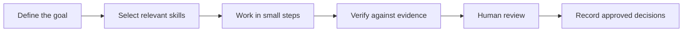

# My AI Skills — v0.4.1

A public, evolving collection of reusable AI-agent instructions for engineering, design, learning, research documentation, and project continuity. Built around practical tasks, human-led decisions, evidence-based verification, and privacy-conscious collaboration.

## Workflow

**Project status:** actively developed; evaluation coverage is preliminary. These skills are instructions, not a standalone agent runtime.

## Skills

| Skill | Purpose |
|---|---|
| `personal-engineering` | Plan, build, debug and verify code in understandable increments |
| `personal-reverse-engineering` | Investigate authorized software behavior with evidence and design independent implementations |
| `personal-design` | Improve visual communication while preserving successful design choices |
| `personal-memory` | Capture verified project decisions and make clear, safe handoffs |
| `personal-tutor` | Tailor practice to observed progress and encourage independent problem solving |
| `personal-document-workflow` | Turn validated research data into auditable figures, spreadsheets, reports and weekly presentations |
| `skill-discovery-evaluation` | Inspect and evaluate third-party skills before adoption |

- `AGENTS.md` defines general collaboration and skill-selection instructions.
- `skills/*/SKILL.md` contains skill-specific workflows.
- `skills/*/references/` provides optional templates and detailed principles.
- `tests/evaluation-cases.md` provides practical evaluations.

## First use in VS Code

1. Clone or pull this repository and open it in VS Code.
2. Review `AGENTS.md` and the relevant `SKILL.md`.
3. If the coding agent recognizes `AGENTS.md` in this workspace, it can use the routing rules. Otherwise, supply the relevant skill explicitly or follow the agent's documented installation process.
4. Run the sample cases in `tests/evaluation-cases.md` and compare results with and without the skill.
5. Revise based on observed results.

## Key boundaries

This library is **not** an automatic long-term memory service. The memory skill describes a process for maintaining approved project notes; it does not monitor conversations or interact with ChatGPT's built-in memory.

Skill files are instructions, not executable guarantees. Agent compatibility and automatic discovery vary by environment.

No external frameworks are required to use these starter instructions. Review any third-party skill before installing it. Never commit API keys, credentials, private transcripts, or sensitive data, even in a private repository.

## Research delivery workflow

For a weekly laboratory report, consult `skills/personal-document-workflow/SKILL.md`, use its `weekly-update-template.md` and quality checklist, and retain evidence supporting each result. No experiment data is included in this skills repository.

## Evaluating external skills

Read `skills/skill-discovery-evaluation/SKILL.md`, apply the safety gate and weighted rubric in `references/evaluation-rubric.md`, and record candidates in `references/candidate-register.md`. Candidates are not installed by being listed. Use synthetic tests and explicit authorization before installation.

## Personal Tutor — initial evaluated session

On 2026-11-02, a Codex-guided Python filtering exercise demonstrated incremental teaching and a successful local run of `temperature_average.py` with output `Valid temperatures: [0, 10, 20]`. The actual average computation and automatic skill discovery were **not** independently verified. See `tests/evaluation-cases.md` for evidence and limitations.

The Tutor skill now follows: **Teach while learning; collaborate while exploring; execute when the user decides; verify before declaring success.** Stop repetitive questioning when the learner has demonstrated the objective or requests to end the exercise.
